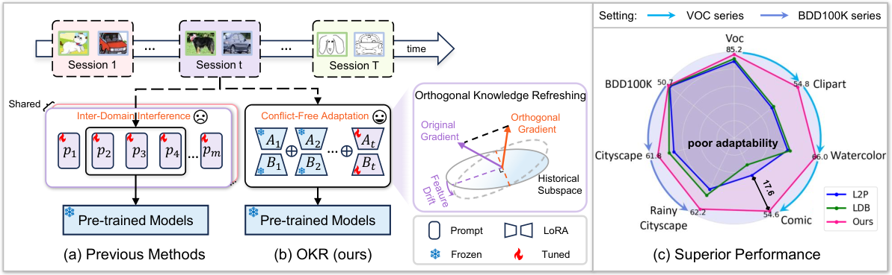
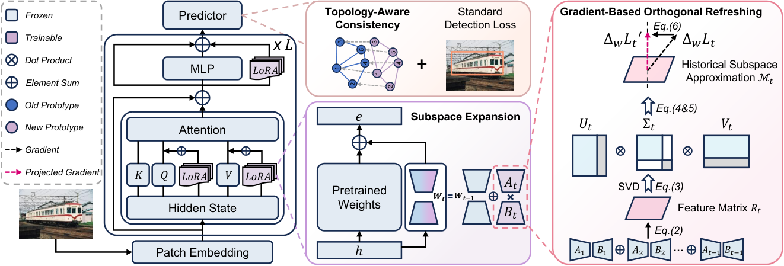
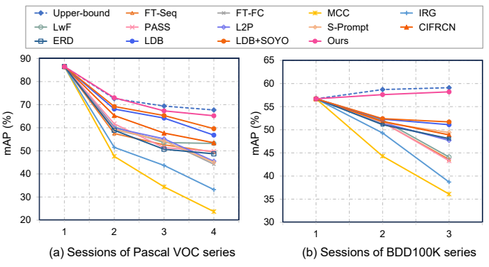

<div align="center">

### Orthogonal Knowledge Refreshing for Domain-Incremental Object Detection

**European Conference on Computer Vision · ECCV 2026**

[](https://arxiv.org/abs/2607.17340)
[](https://arxiv.org/pdf/2607.17340)

[Overview](#overview) · [Method](#method) · [Results](#results) · [Citation](#citation)

</div>

## Overview

**Adapt to new domains while preserving previously learned knowledge.** OKR combines domain-specific low-rank adaptation, orthogonal gradient refreshing, and semantic consistency for exemplar-free domain-incremental object detection.

<p align="center">
  
</p>


## Method
- **Low-rank subspace expansion:** add a dedicated LoRA branch for each domain and fuse branches for prediction.
- **Orthogonal refreshing:** constrain new gradient updates relative to the approximated historical subspace.
- **Topology-aware consistency:** align class-prototype structures across domains.
<p align="center">
  
</p>


## Results

### Final-session performance

**mAP (%) ↑.** Results from Tables 1 and 3 of the [paper](https://arxiv.org/pdf/2607.17340#page=11).

| Method | Pascal VOC series · Session 4 | BDD100K series · Session 3 | VOC-C series · Session 5 |
| :--- | ---: | ---: | ---: |
| LDB | 56.8 | 51.1 | 50.7 |
| LDB + SOYO | 59.6 | 51.7 | — |
| **OKR** | **65.2** | **58.2** | **61.0** |

OKR improves over LDB + SOYO by **+5.6 / +6.5 mAP points** on VOC / BDD100K, and over LDB by **+10.3** on VOC-C. “—” means not reported in the cited comparison.

### Performance across incremental sessions

<p align="center">
  
</p>

*Session-wise comparison (Figure 4). Figures reproduced from the paper; values are reported results.*

## Release status

Paper and citation information are available. Implementation, configurations, and checkpoints are pending.

## Citation

```bibtex
@inproceedings{zhang2026orthogonal,
  title={Orthogonal Knowledge Refreshing for Domain-Incremental Object Detection},
  author={Zhang, Aoting and Yang, Dongbao and Liu, Chang and Hong, Xiaopeng and Ma, Can and Zhou, Yu},
  booktitle={European Conference on Computer Vision},
  pages={473--491},
  year={2026},
  organization={Springer}
}
```
